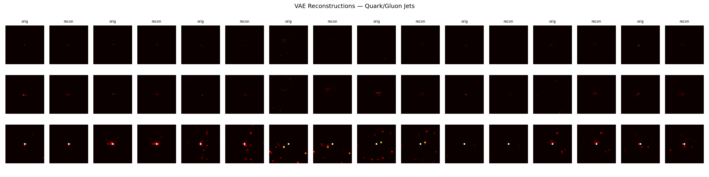

# ML4SCI DeepFalcon: quark/gluon jet images

My solutions to the two common tasks for the ML4SCI DeepFalcon project (GSoC 2026). Both use the quark/gluon jet dataset: 139,306 events, each a 3-channel 125×125 image (ECAL, HCAL, tracks).

| Task | Approach | Result |
|---|---|---|
| [1. Variational autoencoder](common_task1_vae/) | Convolutional VAE: 5 stride-2 conv layers into a 256-dimensional latent space, mirrored decoder, BCE + KL loss | Best validation loss 315.3 after 50 epochs on 50,000 events; [reconstructions](common_task1_vae/outputs/reconstructions.png) |
| [2. Graph neural network](common_task2_gnn/) | Active pixels become a point cloud, linked into a k-NN graph (k = 8), then a 3-layer GCN with mean pooling classifies quark vs gluon (58,113 parameters) | **70.9% test accuracy, 0.77 AUC** on a held-out split of 50,000 jets |

## Why a graph for task 2

Most of each 125×125 image is empty. Keeping only the energy deposits and connecting nearby hits turns a sparse image into a small graph, so the network spends its capacity on the detector hits rather than on blank pixels.

## Run it

Each task folder has its own README, notebook and trained weights (`vae_best.pt`, `gnn_best.pt`).

1. Download `quark-gluon_data-set_n139306.hdf5` (about 700 MB; not tracked here) into the task folder.
2. Install the requirements listed in that task's README.
3. Run the notebook from top to bottom. A GPU is recommended for task 2.

Task 1 also includes `vae_gui.py`, a small [Flet](https://flet.dev) app for browsing jet events and their VAE reconstructions without opening the notebook.

## Stack

Python, PyTorch, PyTorch Geometric, NumPy, h5py, scikit-learn, Matplotlib, Flet
